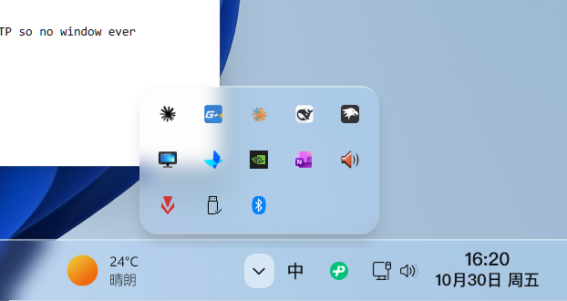
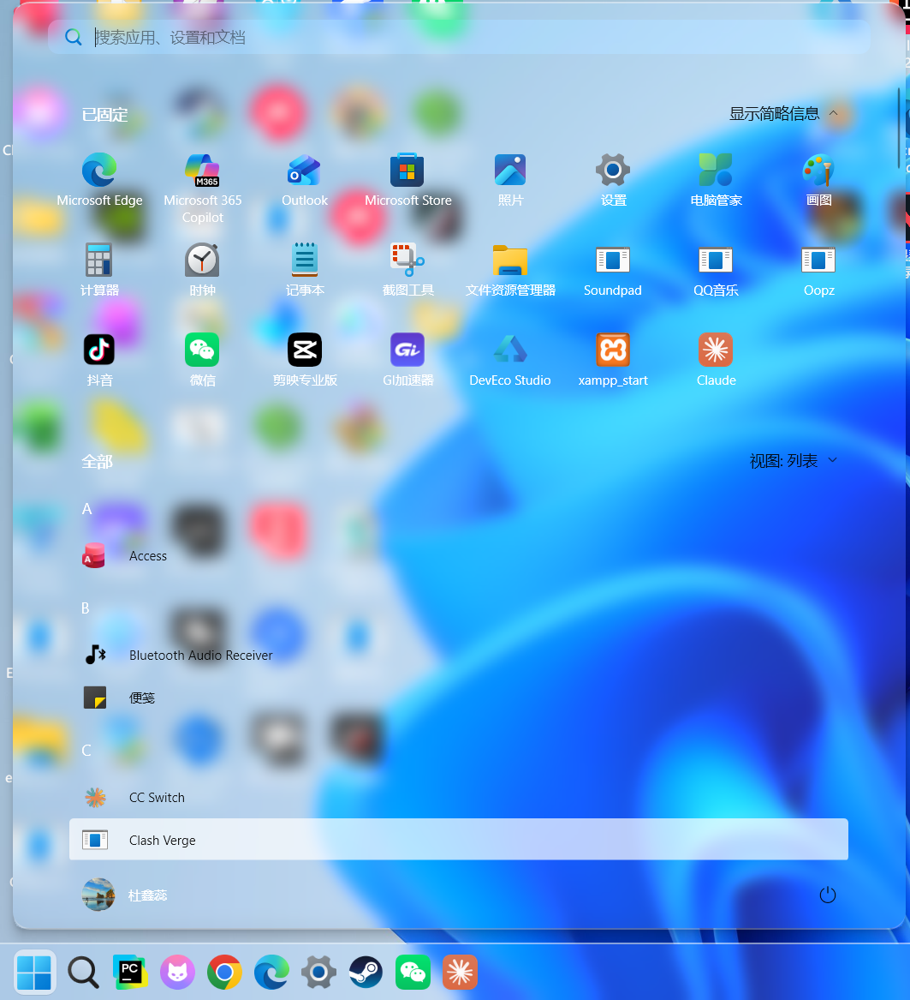

# HarmonyGlass Kit 🌊

**Win11 沉浸光感玻璃桌面** —— 用 Windhawk 把任务栏 / 开始菜单 / 通知中心 / 控制中心 / 媒体卡还原成 HarmonyOS 沉浸光感风格的玻璃材质。

**Windows 11 "Immersive Glass" desktop** — restore the HarmonyOS-style translucent glass across the taskbar, Start menu, notification & control centers via [Windhawk](https://windhawk.net) mods.




> 材质版本 v8：BlurAmount 8 / tintOpacity 0.12 / 饱和 1.35 —— 近零模糊高透射，还原华为「液态玻璃」质感（参考 HarmonyOS 官方参数实测值），而非传统亚克力的重模糊。

## 特性

- 🎨 **单源材质定义**：`material.json` 一处改参数，一条命令应用到全部系统表面
- ⚡ **热重载**：改材质秒级生效，无需重启 explorer（写注册表 + bump `SettingsChangeTime`）
- 🌗 **开始菜单文字自动反色**：采样壁纸亮度自动决定深/浅色文字（换壁纸自动跟随）
- 🪟 **资源管理器窗口玻璃**：DWM backdrop / accent API 两条路线（跨进程、无需提权）
- 📸 **全链路验证工具**：DPI-aware 截图、面板截图、像素级效果验证脚本齐全

## 快速开始

### 1. 安装 Windhawk 和三个 mod

从 [windhawk.net](https://windhawk.net) 安装 Windhawk，然后在 Explore 市场里安装（**只装 mod 本体，不用改任何设置**）：

| Mod | 作用范围 |
|---|---|
| Taskbar Styler | 任务栏 + 托盘弹层 |
| Notification Center Styler | 控制中心 / 通知中心 / 日历 / 媒体卡 |
| Start Menu Styler | 开始菜单 + 搜索 |

### 2. 应用材质（管理员 PowerShell）

```powershell
cd <本目录>
powershell -Command "Start-Process powershell -Verb RunAs -ArgumentList '-NoProfile','-ExecutionPolicy','Bypass','-File','.\recipes\apply_material.ps1' -Wait"
```

### 3. 开始菜单文字自动反色（可选）

```powershell
powershell -Command "Start-Process powershell -Verb RunAs -ArgumentList '-NoProfile','-ExecutionPolicy','Bypass','-File','.\recipes\apply_text_contrast.ps1','-Mode','auto' -Wait"
```

### 4. 资源管理器窗口玻璃（可选）

```powershell
powershell -File .\recipes\set_backdrop.ps1 explorer 3 CabinetWClass
```

完成。任务栏、开始菜单、控制中心、通知中心全部换上玻璃材质。

## 材质调参

编辑 `material.json` 后重跑 `apply_material.ps1`：

```json
{
  "blur": { "amount": 8, "tintColor": "#FFF5F8FC", "tintOpacity": 0.12,
            "tintSaturation": 1.35, "tintLuminosityOpacity": 0.05 },
  "radius": { "panel": 16, "element": 10 }
}
```

| 参数 | 说明 | 建议范围 |
|---|---|---|
| `blur.amount` | 高斯模糊半径 | 5–12（华为风格近零模糊，>12 变浑浊亚克力） |
| `blur.tintOpacity` | 玻璃染色浓度 | 0.08–0.20 |
| `blur.tintSaturation` | 背景饱和度增益 | 1.2–1.5（vibrancy） |
| `radius.panel` | 面板圆角 | 12–20 |

## 脚本清单

| 脚本 | 用途 |
|---|---|
| `recipes\apply_material.ps1` | ★ 主应用器：material.json → 三个 styler（热重载） |
| `recipes\apply_text_contrast.ps1` | ★ 开始菜单文字自动反色 |
| `recipes\cleanup_diag.ps1` | 清理诊断规则残留 |
| `recipes\set_backdrop.ps1` / `set_accent.ps1` | 资源管理器窗口玻璃（DWM / accent 两条路线） |
| `recipes\get_backdrop.ps1` | 读回窗口 backdrop 状态 |
| `recipes\capture_*.ps1` | DPI-aware 截图套件（整屏 / 面板 / 开始菜单） |
| `recipes\sample_wallpaper_luma.py` | 壁纸亮度采样（支持 `--rect` 指定区域） |
| `recipes\watch_wallpaper.ps1` | 壁纸变更监视器（30s 轮询，自动重跑反色） |
| `recipes\focus_window.ps1` | 把指定窗口带前台（调试用） |

## 工作原理（踩坑记录）

本项目摸清的机制与陷阱，全部实测验证过，详见 [MATERIAL.md](MATERIAL.md)：

1. **热重载机制**：Windhawk styler mod 监测注册表 `SettingsChangeTime`，bump 后宿主进程不重启、约 8 秒线程内刷新样式
2. **规则连续索引**：styler 引擎按 `for(i=0;;i++)` 读规则，遇第一个空槽即停——跳索引写 = 静默不读
3. **PowerShell `-like` 方括号陷阱**：`-like 'name[24]*'` 的 `[24]` 是通配字符类，永不匹配字面值名（本项目的红色诊断规则曾因此残留数小时）；注册表值名精确删除一律 `.StartsWith()`
4. **PS 5.1 编码**：所有 `.ps1`/`.json` 必须 UTF-8 **BOM**，否则中文注释按 ANSI 读直接语法报错
5. **高 DPI 截图**：2560×1440 @125% 必须先 `SetProcessDPIAware()`，否则只抓到 80% 左上角

## 能力边界（如实说明）

- ❌ **真折射 / 法线高光**：WindhawkBlur 是单高斯笔刷，无背景采样位移。当前用上下双缘高光线近似边缘折射；真折射需自定义 C++ mod（DComp + Win2D DisplacementMap）
- ❌ **Electron/Chromium 窗口玻璃**（如 VS Code、Claude）：不透明合成层盖住一切 DWM 侧效果
- ⚠️ **资源管理器窗口**：DWM backdrop 可用但**新开窗口不继承**（一次性设置）；常驻需自定义 Windhawk mod
- ⚠️ **开始菜单文字反色**：运行时采样，换壁纸需重跑脚本（或注册 `watch_wallpaper.ps1` 计划任务）

## 免责声明

- 仅修改 Windhawk mod 的注册表设置，不改系统文件；`backup\` 会自动导出改动前的注册表备份
- 所有 mod 本体归 Windhawk 社区作者所有，本项目只提供配置与脚本
- 建议先在非生产环境验证

## License

[MIT](LICENSE) —— 脚本与配置部分。Windhawk mod 本体遵循各自的开源许可。
